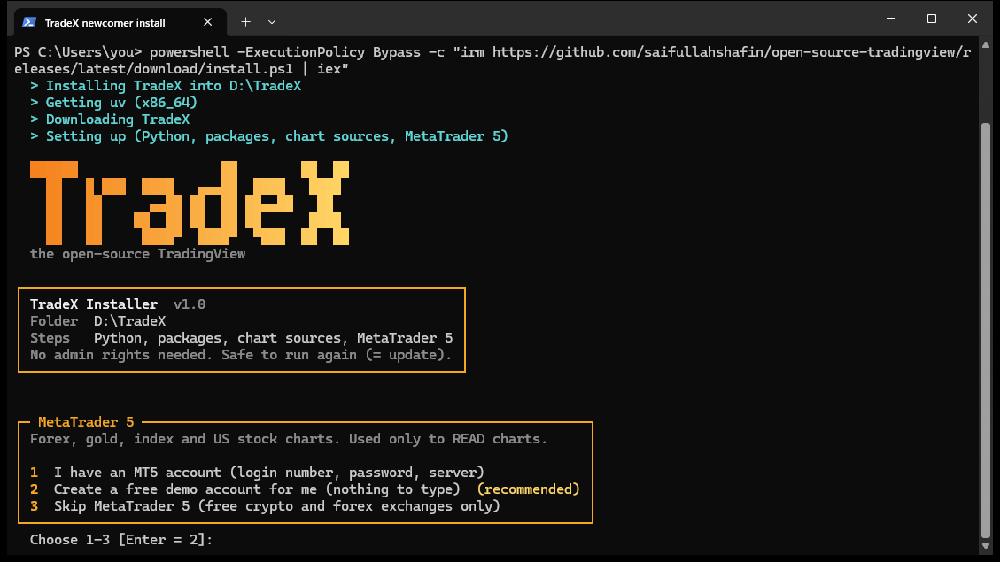
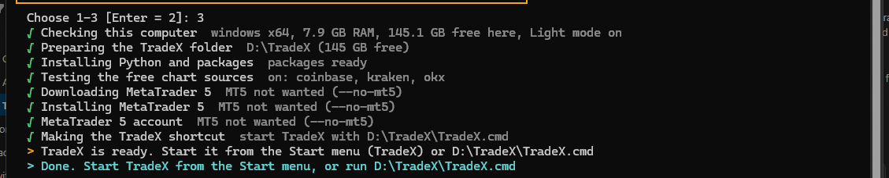

# How to install TradeX (no coding needed)

TradeX is a free chart app, like TradingView, that runs on your own computer. You install it with **one line**.
It takes about **4 minutes**. You do not need to know any code.

---

## What you need
- A Windows 10 or 11 PC (Mac and Linux also work, see the end of this page).
- About 1 GB of free space.
- Internet.
- No admin password is needed.

---

## Step 1: Open PowerShell
1. Press the **Windows key** on your keyboard.
2. Type **PowerShell**.
3. Click **Windows PowerShell**. A blue or black window opens.

## Step 2: Paste the install line
1. Copy this whole line:
   ```
   powershell -ExecutionPolicy Bypass -c "irm https://github.com/saifullahshafin/open-source-tradingview/releases/latest/download/install.ps1 | iex"
   ```
2. Click inside the PowerShell window and **right-click** once. The line is pasted.
3. Press **Enter**.

You will see a big orange **TradeX** title and a box that says where TradeX is going (usually `D:\TradeX`, or your user
folder if you have no D: drive).

## Step 3: Answer one question (MetaTrader 5)
TradeX asks how you want forex, gold and stock charts:



| Press | What it means | Pick this if |
|---|---|---|
| **Enter** (or 2) | TradeX makes a free demo account for you. Nothing to type. | You are new. **Best choice.** |
| 1 | Use your own MetaTrader 5 account. It asks for your **login number**, **server** and **password**. | You already have a broker account. Use the read-only **investor password** if you can. TradeX never saves it. |
| 3 | Skip MetaTrader 5. You still get free crypto and forex charts. | You only want crypto charts, or you are on a slow PC. |

The account is only used to **read charts**. TradeX never places trades.

## Step 4: Wait about 4 minutes
Each line gets a check mark when it is done. Do not close the window.



When you see **"Done"**, TradeX is installed.

## Step 5: Open TradeX
- Click **Start** and open **TradeX**, or
- Double-click **`TradeX.cmd`** in the TradeX folder (for example `D:\TradeX\TradeX.cmd`).

A small black window opens (this is TradeX running; keep it open), and your browser opens the charts at
**http://localhost:8770/hub.html**. To close TradeX, close that black window.

---

## Update to the newest version
Run the **same line from Step 2** again. It keeps your settings and only adds what is new.

## Remove TradeX
Delete the TradeX folder (for example `D:\TradeX`) and the TradeX entry in the Start menu. Nothing else is left behind
by TradeX.

## If something goes wrong
| You see | What to do |
|---|---|
| A red line or a cross, and "Setup stopped" | Run the same line again. It continues where it stopped. |
| "TradeX is already running" | It is already open. Go to http://localhost:8770/hub.html in your browser. |
| "Port 8770 is used by another program" | Another app uses that port. Open the `.env` file in the TradeX folder with Notepad, add `HUB_HTTP_PORT=8790`, save, and start TradeX again. |
| One source light stays grey (for example Bybit) | That exchange blocks your country or network. The other sources still work. |
| "MetaTrader 5 did not show its window" | Run the line again and pick **1** (your own account) or **3** (skip). |
| Running scripts is disabled | Make sure you copied the **whole** line, including `-ExecutionPolicy Bypass`. |

## Mac or Linux
Open **Terminal**, paste this line and press Enter:
```
curl -LsSf https://github.com/saifullahshafin/open-source-tradingview/releases/latest/download/install.sh | sh
```
You get the free crypto and forex charts. MetaTrader 5 charts are Windows-only for now.
